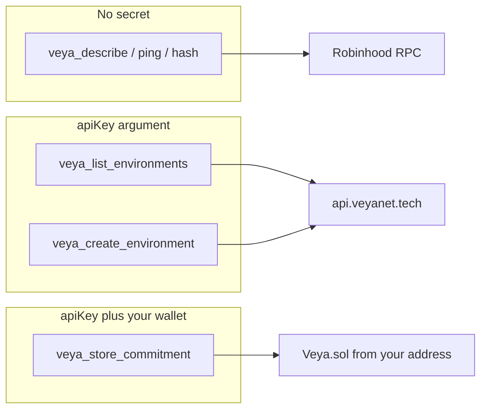

# Authentication & Writes — `@veyanet/mcp`

How this server decides who may **read**, who may use the **product API**, and who pays **gas** on `Veya.sol`.

**[Architecture](./ARCHITECTURE.md)** • **[Tools](./TOOLS.md)** • **[Configuration](./CONFIGURATION.md)** • **[Security](../SECURITY.md)**

---

## Table of contents

1. [Three credentials, three jobs](#1-three-credentials-three-jobs)
2. [Public tools](#2-public-tools)
3. [Product API key](#3-product-api-key)
4. [Guest vs wallet](#4-guest-vs-wallet)
5. [On-chain writes (your wallet)](#5-on-chain-writes-your-wallet)
6. [Funding your wallet](#6-funding-your-wallet)
7. [Where to put the private key](#7-where-to-put-the-private-key)
8. [Failure messages](#8-failure-messages)
9. [Related reading](#9-related-reading)

---

## 1. Three credentials, three jobs

People mix these up. They are not interchangeable.

| Secret | Who issues it | Where it is sent | What it unlocks |
|--------|---------------|------------------|-----------------|
| Nothing | — | — | Describe, ping, hash, verify tx, PQ crypto, public registry, API health |
| Product API key (`veya_dev_…` / `veya_live_…`) | Product site, after wallet login | Tool argument `apiKey` → MCP → `X-Api-Key` toward `api.veyanet.tech` | Rooms, proofs list, Build on the product API |
| Your wallet private key | You | Tool argument `payerPrivateKey` or env `VEYA_PAYER_PRIVATE_KEY` | On-chain writes. `msg.sender` is **your** address |
| Your Solana wallet secret key | You | Tool argument `solanaPrivateKey` on `veya_paid_call` | Metered Call Guard: pays one approved x402 call in USDC on Solana from **your** wallet |
| Your Robinhood Chain key | You | Tool argument `robinhoodPrivateKey` on `veya_paid_call` (and `veya_paid_run` to resume) | Metered Call Guard: signs the `storeCommitment` record and pays its gas from **your** address |

API-key writes are sent from your wallet. You need ETH on Robinhood Chain.



---

## 2. Public tools

These tools run for anyone who can reach the MCP URL:

- Service info: `veya_describe`, `veya_ping_chain`, `veya_hash_blake3`, `veya_verify_transaction`, `veya_api_health`
- `veya_writes_status` (explains own-wallet writes)
- PQ: `veya_pq_keygen`, `veya_pq_sign`, `veya_pq_verify`, `veya_pq_fingerprint`
- Public registry and on-chain **reads**
- `veya_verify_proof_api`

Account memory, consensus, and sealed execution need an API key. They are not in the public list.

`GET /` and `GET /health` also have no auth. Health never prints keys.

---

## 3. Product API key

Create the key at [app.veyanet.tech](https://app.veyanet.tech): connect your wallet, open **System → API Keys**, and create a Dev (`veya_dev_…`) or Live (`veya_live_…`) key. The key is shown once. Guests **cannot** mint keys.

Pass it as the tool argument `apiKey`. MCP forwards product keys as:

```http
X-Api-Key: veya_dev_…
Authorization: Bearer veya_dev_…
```

to `https://api.veyanet.tech`.

If `apiKey` is missing, product tools return `{ "error": "apiKey required" }` instead of calling the API (except `veya_guest_login` and `veya_verify_proof_api`).

`veya_account` asks the product API for the wallet bound to that key. On-chain writes refuse a `payerPrivateKey` whose address does not match that wallet.

---

## 4. Guest vs wallet

`veya_guest_login` still exists for **Use listing**. The JWT is not a write credential.

| Action | Guest JWT | Product API key |
|--------|-----------|-----------------|
| List showcase / Use environments | Yes (scoped) | Yes |
| Create environment (API row) | Refused by MCP | Yes |
| Deploy agent / protected execution | Refused by MCP / API 403 | Yes |
| On-chain write | Refused. Create a product API key at app.veyanet.tech and fund your wallet. | Yes, from **your** wallet |

Creating an environment in the product API does **not** spend gas. Registering that room on `Veya.sol` does.

---

## 5. On-chain writes (your wallet)

Write tools talk to `Veya.sol` through `@veyanet/sdk` `EvmAnchor`. They spend your ETH on the selected network.

Every write still:

1. Requires a product `apiKey`
2. Resolves `payerPrivateKey` (tool arg or `VEYA_PAYER_PRIVATE_KEY`)
3. Checks that the payer address matches the wallet on that API key
4. Checks the wallet has a non-zero ETH balance
5. Sends the tx; `from` in the tool result is your address

Write tools:

| Tool | Job |
|------|-----|
| `veya_store_commitment` | `storeCommitment` |
| `veya_attest_execution` | `attestExecution` |
| `veya_register_environment` | `registerEnvironment` (optional product `environmentId` then confirm on the product API) |
| `veya_register_pq_onchain` | SDK helper: keygen + register + companion commitment |
| `veya_anchor_pq_attestation` | `anchorPqAttestation` |
| `veya_anchor_proof` | BLAKE3 of label+content, then `storeCommitment` from your wallet |

SDK writes still call `ensureRobinhoodChain()`. Wrong `eth_chainId` → fail closed.

---

## 6. Funding your wallet

If the wallet balance is `0`, or the node returns insufficient funds, the tool returns one sentence for the selected profile.

Mainnet:

```text
Your wallet has no ETH on Robinhood Chain. Add funds and try again.
```

Testnet, when `ROBINHOOD_NETWORK=testnet`:

```text
Mainnet: 'Your wallet has no ETH on Robinhood Chain. Add funds and try again.' Testnet: 'You don't have testnet tokens. Please get them for the transaction.'
```

Fund the **same** address that minted the API key. On Testnet, use https://faucet.testnet.chain.robinhood.com/

---

## 7. Where to put the private key

Prefer a **self-hosted** `veya-mcp` with env:

```bash
VEYA_PAYER_PRIVATE_KEY=0x…
```

so the agent does not paste the key into a tool argument.

If you pass `payerPrivateKey` to the **public** HTTP URL, that host holds the key for the duration of the call. Do not use a mainnet key. Testnet only.

**Metered Call Guard (`veya_paid_call`).** A metered call takes three values: your product `apiKey` (checked against the VEYA API; the run is saved to that account), your **Solana** secret key in `solanaPrivateKey` (base58 or a JSON array of 64 numbers; pays the USDC) and your **Robinhood Chain** key in `robinhoodPrivateKey` (signs the record and pays its gas; it does not have to be the API key's wallet). Keys are used in memory only: not stored, logged, written to state, receipts or your account, or returned. The Solana key bytes are cleared after the call. The host still sees the keys while the call runs, so use dedicated wallets that hold only what you plan to spend. VEYA's policy caps what one call and one task can cost. Missing values return `API_KEY_REQUIRED`, `SOLANA_KEY_REQUIRED` or `ROBINHOOD_KEY_REQUIRED`; malformed ones `API_KEY_INVALID`, `SOLANA_KEY_INVALID` or `ROBINHOOD_KEY_INVALID`.

Never log, screenshot, or commit the key. MCP does not put it in `/health`, landing HTML, or tool success payloads.

---

## 8. Failure messages

| Situation | Typical result |
|-----------|----------------|
| Missing `apiKey` | `{ "error": "apiKey required" }` |
| Guest JWT on a write tool | Create a product API key at https://app.veyanet.tech (System → API Keys) and fund your wallet. |
| Missing payer | `payerPrivateKey required` |
| Metered call without `apiKey` / Solana key / Robinhood Chain key | `API_KEY_REQUIRED` / `SOLANA_KEY_REQUIRED` / `ROBINHOOD_KEY_REQUIRED` (nothing checked, signed or spent) |
| Metered call with a revoked or unknown `apiKey` | `API_KEY_INVALID` |
| Metered call with a malformed key | `SOLANA_KEY_INVALID` / `ROBINHOOD_KEY_INVALID` |
| Metered call, wallet short of USDC or ETH | `PAYER_INSUFFICIENT_FUNDS` / `ROBINHOOD_INSUFFICIENT_GAS` (refused before signing) |
| Payer ≠ API key wallet | payerPrivateKey does not match the wallet on this API key |
| Empty / unfunded wallet | `Mainnet: 'Your wallet has no ETH on Robinhood Chain. Add funds and try again.' Testnet: 'You don't have testnet tokens. Please get them for the transaction.'` |
| Guest + create environment | MCP `isError` (mint a product API key) |
| Wrong chain | SDK chain mismatch on send |

---

## 9. Related reading

- Tool catalog: [TOOLS.md](./TOOLS.md)
- Chain constants: [NETWORK_PIN.md](./NETWORK_PIN.md)
- SDK crypto and writes: [SDK_BRIDGE.md](./SDK_BRIDGE.md)
