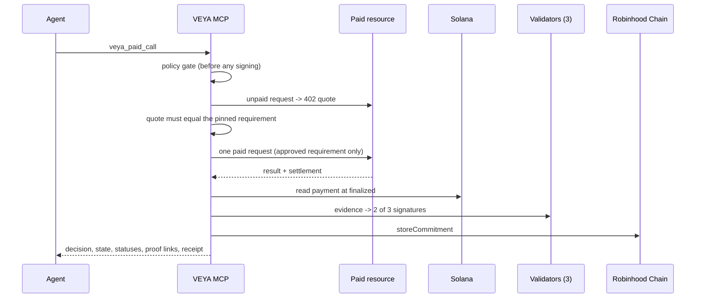

# Paid Call Guard — `@veyanet/mcp`

Paid Call Guard lets an agent call a paid x402 resource through one guarded VEYA tool. VEYA checks the call against a fixed policy **before** anything is signed, pays exactly the quote it approved, checks the payment on Solana at `finalized`, has three validators sign the evidence (2 of 3 must agree), and anchors a commitment on Robinhood Chain. Every run gets a receipt with proof links.

The feature is **opt-in**. When `VEYA_PAID_CALLS` is not `1`, the three tools and the receipt route do not exist and the server behaves exactly as described in [TOOLS.md](./TOOLS.md).

**[Tools](./TOOLS.md#7-paid-call-guard-opt-in)** • **[Architecture](./ARCHITECTURE.md#18-paid-call-guard)** • **[Configuration](./CONFIGURATION.md#11-paid-call-guard)** • **[Verification](./VERIFICATION.md#9-procedure-e--paid-call-guard-runs)**

---

## Table of contents

1. [What it does](#1-what-it-does)
2. [Flow](#2-flow)
3. [Tools](#3-tools)
4. [Payer paths](#4-payer-paths)
5. [Policy](#5-policy)
6. [Run states](#6-run-states)
7. [Receipts](#7-receipts)
8. [Set up](#8-set-up)
9. [Call it from an agent](#9-call-it-from-an-agent)
10. [Kill switch](#10-kill-switch)
11. [Limits](#11-limits)

---

## 1. What it does

| Step | Who | Result |
|------|-----|--------|
| Policy gate | VEYA | Tool, host, resource, network, asset, payee, per-call cap, task budget, call count, approval threshold and input are checked. A denied call is never signed. |
| Payment | Payer path from config | Exactly one payment for the one requirement VEYA approved. |
| Payment check | VEYA | The Solana transaction is read at `finalized`: payer, payee, mint and amount must match. |
| Validators | 3 validator nodes | Each node re-reads the payment through its **own** Solana RPC provider and signs the evidence with ML-DSA-44. 2 of 3 must agree. |
| Record | VEYA | `storeCommitment` on `Veya.sol` (Robinhood Chain). |
| Receipt | VEYA | HTML and JSON receipt with the decision, three statuses and proof links. No request or answer content. |

A receipt is cross-chain evidence: the payment settles on Solana and the commitment is anchored on Robinhood Chain afterwards. It is not one atomic cross-chain transaction, and it does not prove that the resource's answer is correct.

---

## 2. Flow



---

## 3. Tools

| Tool | Pays | Purpose |
|------|------|---------|
| `veya_paid_discover` | Never | Lists the resources policy allows, their input fields, a live unpaid quote and a policy preview. |
| `veya_paid_call` | Once per idempotency key | Runs one guarded paid call. |
| `veya_paid_run` | Never | Reads a run. With `resume: true` it retries Solana verification or anchoring, or looks for an on-chain payment after a resource error. |

`veya_paid_call` arguments:

| Argument | Required | Meaning |
|----------|----------|---------|
| `taskId` | yes | Groups calls under one task budget. |
| `idempotencyKey` | yes (8–120 chars) | Same key = same run. A repeat never pays again; it returns the stored run with `replay: true`. Keys are unique per state folder, so use a new random value (for example a UUID) for each new call and keep it to retry. |
| `resourceId` | no | A resource id from `veya_paid_discover`. Default: the first configured resource. |
| `input` | yes | Object with the resource's input fields (string values). Unknown fields are refused. |
| `taskBudgetAtomic` | no | Task budget in atomic units (USDC has 6 decimals). Cannot exceed the policy maximum. |
| `url` | no | Only for testing the gate. Any URL other than the pinned resource URL is denied. |

Reply fields: `runId`, `decision` (`allowed` / `blocked`), `state`, `reason`, `statuses` (`responseReceived`, `paymentVerified`, `veyaRecordAnchored`), `payment` (`signature`, `solscan`, `feeSignature`), `veya` (`commitment`, `tx`, `blockscout`), `receipt`, `output` (the resource answer, returned to the caller only), and `replay` on a repeat.

`veya_paid_run` arguments: `runId` (required) and `resume` (optional, `true` to continue a stopped run; never pays).

There is no key, wallet, transfer, swap, trade or bridge tool.

---

## 4. Payer paths

Each provider entry in the config names its payer path; a resource may override it.

| `payer` | How VEYA pays | Extra fee |
|---------|---------------|-----------|
| `xpay-sdk` | The provider's xPay SDK, `use()` only, with its guardrails on (`maxPerTx`, `maxPerDay`, `allowedHosts`, approval above a threshold). VEYA wraps the SDK's signing check so any requirement other than the approved one is refused. | The SDK's platform fee, counted in the task budget. |
| `x402-exact` | The standard x402 `exact` scheme on Solana, built with the official `@x402/core` and `@x402/svm` client libraries. VEYA offers the library only the approved requirement, checks the signed payload still matches it, then sends one request. | None. |

Both paths pay only after the policy gate, and neither is retried automatically.

---

## 5. Policy

Policy lives in the config file (see [CONFIGURATION.md](./CONFIGURATION.md#11-paid-call-guard)). Deny codes:

| Code | Meaning |
|------|---------|
| `TOOL_NOT_ALLOWED` | Tool is not on the allowlist. |
| `HOST_NOT_ALLOWED` | Host is not on the allowlist, or not `https`. |
| `RESOURCE_NOT_ALLOWED` | Resource id or URL is not pinned. |
| `NETWORK_NOT_ALLOWED` / `ASSET_NOT_ALLOWED` / `PAYEE_NOT_ALLOWED` | Quote is outside the allowlists. |
| `CHALLENGE_CHANGED` | Quote differs from the pinned requirement (amount, scheme, fee payer, x402 version, extra options). |
| `OVER_PER_CALL_CAP` | Price is above the per-call cap. |
| `APPROVAL_REQUIRED` | Cost is above the approval threshold (no approver is configured, so the call is denied). |
| `OVER_TASK_BUDGET` | Cost does not fit the task budget, or the requested budget is above the policy maximum, or the task hit its call limit. |
| `INPUT_INVALID` | Missing, unknown or malformed input field. |
| `CHALLENGE_UNAVAILABLE` | The unpaid quote could not be read. |
| `EMERGENCY_DISABLED` | Kill switch is on. |

Parallel calls on one task reserve budget first, so they cannot spend past it together.

---

## 6. Run states

```text
prepared → authorized → paid → verified → committed
```

| Stop state | Meaning | Next step |
|------------|---------|-----------|
| `denied` | Policy said no. Nothing was signed. | Fix the request. |
| `payment_failed` | Refused before signing (guardrail, pin, no payer key). Nothing spent. | Fix config. |
| `resource_error` | Error after authorization. Spend is held; VEYA looks for the payment on chain and keeps it as evidence. | `veya_paid_run` with `resume: true`. |
| `payment_unverifiable` | Payment not yet visible at `finalized`, or RPC down. | `resume: true` later. |
| `quorum_failed` | Fewer than 2 of 3 validators agreed. No commitment is anchored. | Check validators. |
| `commit_failed` | Anchoring failed. | `resume: true` anchors once; a commitment already on chain is never re-sent. |

---

## 7. Receipts

`GET /receipts/paid/<runId>` returns an HTML receipt; `GET /receipts/paid/<runId>.json` returns the same public fields. Both show the decision, the three statuses, the payer path and proof links (Solscan, Blockscout). Neither shows the request input or the answer. When `VEYA_PAID_RECEIPTS_BASE_URL` is set, tool replies link to this route.

---

## 8. Set up

Operators only. Full steps: the repository's `DEPLOY.md`.

1. Build the MCP (`npm ci && npm run build`).
2. Put two key files on the server, outside the repo, mode `0600`: a Solana payer keypair (JSON array) and a Robinhood Chain anchor key.
3. Start three validator nodes (`validator-node` in `fleet/`; `scripts/validators.sh` starts all three), each with its own Solana RPC provider.
4. Set the env vars below and start `node dist/cli.js` (HTTP) or `node dist/cli.js --stdio` (stdio). Over HTTP, clients send the host's MCP bearer token when the host sets `MCP_API_KEY`.

| Variable | Required | Purpose |
|----------|----------|---------|
| `VEYA_PAID_CALLS` | yes (`1`) | Registers the three tools and the receipt route. |
| `VEYA_PAID_ROOT` | yes | Folder that holds `config/`, `state/` and `receipts/`. |
| `VEYA_PAID_SOLANA_KEY_PATH` | for paid calls | Solana payer key file. Unset: paid calls stop at `payment_failed` (`PAYER_NOT_CONFIGURED`). |
| `VEYA_PAID_ANCHOR_KEY_PATH` | for records | Anchor key file. Unset: runs stop at `commit_failed` (resumable). |
| `VEYA_PAID_RECEIPTS_BASE_URL` | recommended | Public base URL of `/receipts/paid`. |
| `VEYA_PAID_VALIDATOR_NODES` | if validators are remote | Comma-separated validator base URLs. |
| `VEYA_PAID_CONFIG`, `VEYA_PAID_STATE_DIR`, `VEYA_PAID_RECEIPTS_DIR` | optional | Override default paths. |
| `VEYA_PAID_CALLS_DISABLED` | emergency | `1` turns the kill switch on. |

One MCP process per state folder. The process writes `state/ledger.lock`; a second process that points at the same folder refuses to start the guard (`STATE_LOCKED`). To run an HTTP server and a stdio server side by side, give each its own `VEYA_PAID_STATE_DIR`.

---

## 9. Call it from an agent

```json
{ "name": "veya_paid_discover", "arguments": {} }
```

```json
{
  "name": "veya_paid_call",
  "arguments": {
    "taskId": "my-task",
    "idempotencyKey": "3f6c2a9e-5b1d-4c7a-9e2f-8a1b4d6c0e71",
    "resourceId": "tokens.risk-summary",
    "input": { "mint": "EPjFWdd5AufqSSqeM2qN1xzybapC8G4wEGGkZwyTDt1v" }
  }
}
```

```json
{
  "name": "veya_paid_call",
  "arguments": {
    "taskId": "my-task",
    "idempotencyKey": "b2e4d8f1-7a3c-4e9b-a6d5-1c0f9e8b7a62",
    "resourceId": "tokens.asset-risk-summary",
    "input": { "assetId": "solana" }
  }
}
```

`policyPreview.callCostAtomic` in the discover reply is what one call takes from the task budget: the price, plus the platform fee on the `xpay-sdk` path.

A runnable client is in `scripts/paid-call-example.mts` (run from the `mcp/` folder). By default it only reads and shows one blocked call; it pays only with `PAID_CONFIRM=1`:

```bash
VEYA_MCP_URL=<your MCP URL> VEYA_MCP_TOKEN=<token> npx tsx scripts/paid-call-example.mts
VEYA_MCP_URL=<your MCP URL> VEYA_MCP_TOKEN=<token> PAID_CONFIRM=1 npx tsx scripts/paid-call-example.mts
```

Optional env: `PAID_RESOURCE`, `PAID_INPUT` (JSON), `PAID_TASK_ID`, `PAID_IDEMPOTENCY_KEY`.

Pick a subject the resource knows. A provider may take the payment and still answer `404` for a token it does not cover; VEYA then records `resource_error`, keeps the payment as evidence and does not anchor.

---

## 10. Kill switch

Any one of these blocks every paid call before any request is made:

- `"enabled": false` in the config file
- `VEYA_PAID_CALLS_DISABLED=1`
- a file named `DISABLED` in the state folder

A call made while the switch is on returns `decision: "blocked"`, `state: "disabled"` and a reason that starts with `EMERGENCY_DISABLED`. No run is created and nothing is paid.

To remove the feature, unset `VEYA_PAID_CALLS` and restart.

---

## 11. Limits

- Solana mainnet, USDC, x402 `exact` scheme only.
- One pinned requirement per resource. A quote change is denied until the config is updated.
- Validators confirm the payment and the evidence hash, not the quality of the answer.
- Spend after an error is held conservatively until the on-chain payment is found.
- One process per state folder. Budgets and idempotency are enforced per state folder, not across folders.
- The task budget is a USDC budget enforced by VEYA before payment. It is not an onchain limit. `Veya.sol` spend values are in Robinhood Chain native wei, so the commitment on Robinhood Chain is not a USD or USDC spend limit.
- Pinned versions: xPay SDK 0.2.38, `@x402/core` and `@x402/svm` 2.28.0, `@veyanet/sdk` 1.2.9. The same pins are in `config/paid-calls.json` (`pins`) and `mcp/package.json`.
