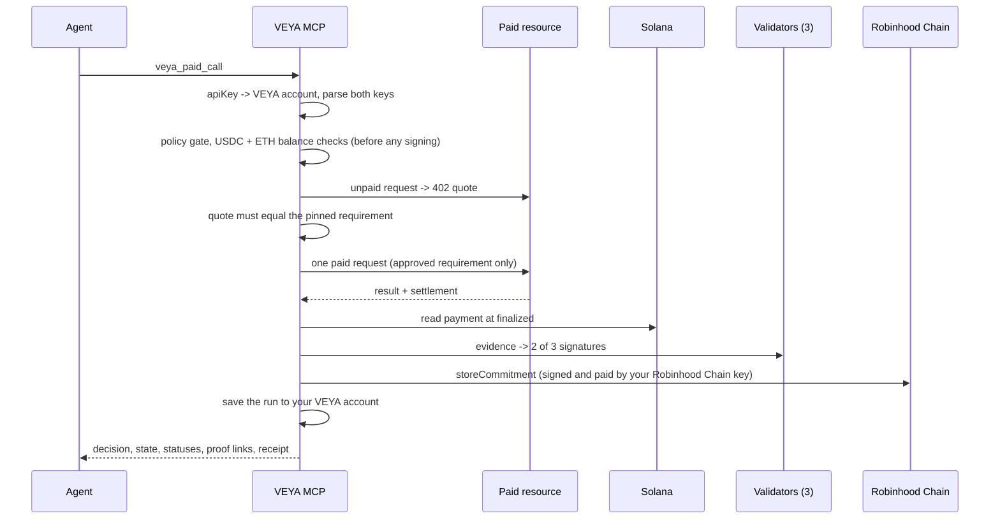

# Paid Call Guard — `@veyanet/mcp`

Paid Call Guard lets an agent call a paid x402 resource through one guarded VEYA tool. VEYA checks the call against a fixed policy **before** anything is signed, pays exactly the quote it approved, checks the payment on Solana at `finalized`, has three validators sign the evidence (2 of 3 must agree), and anchors a commitment on Robinhood Chain. Every run gets a receipt with proof links.

**Your account, your wallets.** Every `veya_paid_call` needs three values:

- `apiKey`: your VEYA product API key (`veya_dev_...` or `veya_live_...`, from [app.veyanet.tech](https://app.veyanet.tech) → System → API Keys). Every run is saved to that key's VEYA account.
- `solanaPrivateKey`: your Solana wallet secret key. It pays the USDC for the call.
- `robinhoodPrivateKey`: your Robinhood Chain (EVM) private key. It signs the `storeCommitment` record on `Veya.sol` and pays its ETH gas. It does not have to be the wallet that owns the API key's account; the run records which address signed.

Before anything is signed VEYA checks the API key, that both keys parse, the policy, that your Solana wallet holds enough USDC and that your Robinhood Chain wallet holds enough ETH for the record. Keys are used in memory for that one call only. They are never stored, logged, written to state, receipts or your account, or returned.

The feature is enabled per server with `VEYA_PAID_CALLS=1`. When it is not `1`, the three tools and the receipt route do not exist and the server behaves exactly as described in [TOOLS.md](./TOOLS.md). Check `/health` or `veya_describe` (`paidCallGuard.enabled`) to see whether a server has it on.

**[Tools](./TOOLS.md#7-paid-call-guard)** • **[Architecture](./ARCHITECTURE.md#18-paid-call-guard)** • **[Configuration](./CONFIGURATION.md#11-paid-call-guard)** • **[Verification](./VERIFICATION.md#9-procedure-e--paid-call-guard-runs)**

---

## Table of contents

1. [What it does](#1-what-it-does)
2. [Flow](#2-flow)
3. [Tools](#3-tools)
4. [Payer paths](#4-payer-paths)
5. [Policy](#5-policy)
6. [Run states](#6-run-states)
7. [Receipts](#7-receipts)
8. [Set up](#8-set-up)
9. [Call it from an agent](#9-call-it-from-an-agent)
10. [Kill switch](#10-kill-switch)
11. [Limits](#11-limits)

---

## 1. What it does

| Step | Who | Result |
|------|-----|--------|
| Policy gate | VEYA | Tool, host, resource, network, asset, payee, per-call cap, task budget, call count, approval threshold and input are checked. A denied call is never signed. |
| Account | VEYA API | The `apiKey` must belong to a VEYA account (guest keys and revoked keys are refused). |
| Pre-checks | VEYA | Both keys parse, USDC balance on Solana, ETH for gas on Robinhood Chain, `Veya.sol` environment exists. |
| Payment | Your Solana wallet (`solanaPrivateKey`), through the payer path from config | Exactly one payment for the one requirement VEYA approved. |
| Payment check | VEYA | The Solana transaction is read at `finalized`: payer, payee, mint and amount must match. |
| Validators | 3 validator nodes | Each node re-reads the payment through its **own** Solana RPC provider and signs the evidence with ML-DSA-44. 2 of 3 must agree. |
| Record | Your Robinhood Chain wallet (`robinhoodPrivateKey`) | `storeCommitment` on `Veya.sol`, sent and paid by your address. |
| Account record | VEYA API | The run (state, payment, validators, record, receipt link; no input, answer or keys) is saved to your VEYA account. |
| Receipt | VEYA | HTML and JSON receipt with the decision, three statuses and proof links. No request or answer content. |

A receipt is cross-chain evidence: the payment settles on Solana and the commitment is anchored on Robinhood Chain afterwards. It is not one atomic cross-chain transaction, and it does not prove that the resource's answer is correct.

---

## 2. Flow



---

## 3. Tools

| Tool | Pays | Purpose |
|------|------|---------|
| `veya_paid_discover` | Never | Lists the resources policy allows, their input fields, a live unpaid quote, a policy preview and the default `Veya.sol` environment. No key needed. |
| `veya_paid_call` | Once per idempotency key | Runs one guarded paid call. |
| `veya_paid_run` | Never | Lists the runs saved to your VEYA account, or reads one. With `resume: true` it retries Solana verification, the 2-of-3 validator check (`quorum_failed`) or anchoring, or looks for an on-chain payment after a resource error. |

`veya_paid_call` arguments:

| Argument | Required | Meaning |
|----------|----------|---------|
| `apiKey` | yes | Your VEYA product API key. Missing: `API_KEY_REQUIRED`. Unknown, revoked or guest: `API_KEY_INVALID`. |
| `solanaPrivateKey` | yes | Your Solana secret key: base58 (wallet export) or a JSON array of 64 numbers (keypair file). Pays the USDC. Missing: `SOLANA_KEY_REQUIRED`. Malformed: `SOLANA_KEY_INVALID`. |
| `robinhoodPrivateKey` | yes | Your Robinhood Chain private key (`0x` + 64 hex). Signs the record and pays its gas. Missing: `ROBINHOOD_KEY_REQUIRED`. Malformed: `ROBINHOOD_KEY_INVALID`. |
| `taskId` | yes | Groups calls under one task budget, per VEYA account. |
| `idempotencyKey` | yes (8–120 chars) | Same key = same run, per VEYA account. A repeat never pays again; it returns the stored run with `replay: true`. Use a new random value (for example a UUID) for each new call and keep it to retry. |
| `resourceId` | no | A resource id from `veya_paid_discover`. Default: the first configured resource. |
| `input` | yes | Object with the resource's input fields (string values). Unknown fields are refused. |
| `taskBudgetAtomic` | no | Task budget in atomic units (USDC has 6 decimals). Cannot exceed the policy maximum. |
| `environmentUuid` | no | A `Veya.sol` environment to record under, for example one you registered with `veya_register_environment`. Default: the environment shown by `veya_paid_discover`. An unknown environment is refused before signing (`ENVIRONMENT_NOT_FOUND`). |
| `url` | no | Only for testing the gate. Any URL other than the pinned resource URL is denied. |

Any other argument (including the old name `payerPrivateKey`) is refused with `INPUT_INVALID`; names and values are never echoed.

Reply fields: `runId`, `decision` (`allowed` / `blocked` / `pending`), `state`, `reason`, `statuses` (`responseReceived`, `paymentVerified`, `veyaRecordAnchored`), `payment` (`signature`, `solscan`, `feeSignature`), `validators` (`agreed`, `required`, `total`, `reached`), `veya` (`commitment`, `tx`, `blockscout`, `anchor`: `anchored` / `failed` / `pending` / `not_attempted`), `veya.from` (the address that signed the record), `receipt`, `account` (`saved: true`, or `saved: false` with a reason), `output` (the resource answer, returned to the caller only), and `replay` on a repeat.

**Refusals.** Every blocked or refused `veya_paid_call` reply has the same shape: `decision: "blocked"`, `state`, a stable machine `code` (for example `API_KEY_REQUIRED`, `SOLANA_KEY_INVALID`, `HOST_NOT_ALLOWED`, `OVER_TASK_BUDGET`, `INPUT_INVALID`, `EMERGENCY_DISABLED`), a readable `reason` that starts with the same code, and `payment: null`. Match on `code`, not on the reason text.

**Success.** A committed run's `reason` is a sentence such as `Recorded on Robinhood Chain in block 97565858, transaction 0x…`. The transaction hash is also in `veya.tx` with its Blockscout link in `veya.blockscout`.

**Amounts and limits.** `veya_paid_discover`, `veya_describe` and `/health` (`paidCallGuard.limits`) show the limits read from the policy config, in USDC atomic units (6 decimals, `10000` = 0.01 USDC):

| Field | Meaning | Hosted value |
|-------|---------|--------------|
| `perCallCapAtomic` | Largest provider quote one call may accept. | `10000` (0.01 USDC) |
| `perCallTotalMaxAtomic` | Largest total one call may charge to the task budget (provider quote plus any provider fee). | `20000` (0.02 USDC) |
| `taskBudgetMaxAtomic` | Largest `taskBudgetAtomic` you may pass. A larger value is refused with `OVER_TASK_BUDGET`. | `40000` (0.04 USDC) |
| `defaultTaskBudgetAtomic` | Budget used when `taskBudgetAtomic` is omitted. | `40000` (0.04 USDC) |
| `maxCallsPerTask` | Calls allowed under one `taskId`. | `2` |

For each resource, `veya_paid_discover` also returns `amounts`: `providerQuoteAtomic` (the provider's x402 quote), `providerFeeAtomic` and `totalChargedAtomic` (what counts against your task budget), with a short `note`. `tokens.risk-summary` uses the provider's xPay SDK, which charges its own platform fee of `10000` as a second USDC transfer on each call, so its total is `20000`. `tokens.asset-risk-summary` uses the standard x402 path with no extra fee, so its total equals the quote, `10000`.

`veya_paid_run` arguments: `apiKey` (required), `runId` (optional; omit it to list the runs saved to your account), `resume` (optional, `true` to continue a stopped run; never pays) and `robinhoodPrivateKey` (needed to resume a `commit_failed` run, because your key signs the record). A run that belongs to another VEYA account reads as `unknown run`. `veya_paid_run` is private to the account of the `apiKey` you pass: another key cannot list or read your runs.

The order of checks is: kill switch, key format, API key (VEYA account), idempotent replay, policy gate, environment and ETH balance, USDC balance, then payment. A call refused at the key or API key step returns `decision: "blocked"` before anything is checked, signed or paid; no run is created and the idempotency key can be used again. Later refusals create a run (saved to your account) that shows the reason.

There is no transfer, swap, trade or bridge tool, and no tool returns a key.

---

## 4. Payer paths

Each provider entry in the config names its payer path; a resource may override it.

| `payer` | How VEYA pays | Extra amount |
|---------|---------------|-----------|
| `xpay-sdk` | The provider's xPay SDK, `use()` only, with its guardrails on (`maxPerTx`, `maxPerDay`, `allowedHosts`, approval above a threshold). VEYA wraps the SDK's signing check so any requirement other than the approved one is refused. | The SDK's own platform amount, counted in the task budget. |
| `x402-exact` | The standard x402 `exact` scheme on Solana, built with the official `@x402/core` and `@x402/svm` client libraries. VEYA offers the library only the approved requirement, checks the signed payload still matches it, then sends one request. | None. |

Both paths pay only after the policy gate, and neither is retried automatically.

---

## 5. Policy

Policy lives in the config file (see [CONFIGURATION.md](./CONFIGURATION.md#11-paid-call-guard)). Deny codes:

| Code | Meaning |
|------|---------|
| `TOOL_NOT_ALLOWED` | Tool is not on the allowlist. |
| `HOST_NOT_ALLOWED` | Host is not on the allowlist, or not `https`. |
| `RESOURCE_NOT_ALLOWED` | Resource id or URL is not pinned. |
| `NETWORK_NOT_ALLOWED` / `ASSET_NOT_ALLOWED` / `PAYEE_NOT_ALLOWED` | Quote is outside the allowlists. |
| `CHALLENGE_CHANGED` | Quote differs from the pinned requirement (amount, scheme, `feePayer`, x402 version, extra options). |
| `OVER_PER_CALL_CAP` | The quoted amount is above the per-call cap. |
| `APPROVAL_REQUIRED` | The call amount is above the approval threshold (no approver is configured, so the call is denied). |
| `OVER_TASK_BUDGET` | The call amount does not fit the task budget, or the requested budget is above the policy maximum, or the task hit its call limit. |
| `INPUT_INVALID` | Missing, unknown or malformed input field. |
| `CHALLENGE_UNAVAILABLE` | The unpaid quote could not be read. |
| `EMERGENCY_DISABLED` | Kill switch is on. |
| `API_KEY_REQUIRED` / `API_KEY_INVALID` | No `apiKey`, or the key is malformed, unknown, revoked or a guest key. Nothing was signed or paid. |
| `API_UNAVAILABLE` | The VEYA API could not be reached to check the key. Nothing was signed or paid. |
| `SOLANA_KEY_REQUIRED` / `SOLANA_KEY_INVALID` | `solanaPrivateKey` missing or not a Solana secret key. Nothing was checked or paid. |
| `ROBINHOOD_KEY_REQUIRED` / `ROBINHOOD_KEY_INVALID` | `robinhoodPrivateKey` missing or not a 32-byte hex key. Nothing was checked or paid. |
| `ENVIRONMENT_NOT_FOUND` | `environmentUuid` is not registered on `Veya.sol`. Refused before signing. |
| `ROBINHOOD_INSUFFICIENT_GAS` | Your Robinhood Chain wallet holds too little ETH to record the run. Refused before signing. |
| `PAYER_INSUFFICIENT_FUNDS` | Your Solana wallet holds less USDC than the call needs. Refused before signing; nothing was paid. |
| `IN_PROGRESS` | A call with the same `idempotencyKey` is still running (`decision: "pending"`). It will not pay again; read it with `veya_paid_run`. |

Parallel calls on one task reserve budget first, so they cannot spend past it together.

---

## 6. Run states

```text
prepared → authorized → paid → verified → committed
```

| Stop state | Meaning | Next step |
|------------|---------|-----------|
| `denied` | Policy said no. Nothing was signed. | Fix the request. |
| `payment_failed` | Refused before signing (guardrail, pin, wallet balance too low). Nothing spent. The reason is in the reply and the receipt. | Fund the wallet or fix config. |
| `resource_error` | Error after authorization. Spend is held; VEYA looks for the payment on chain and keeps it as evidence. | `veya_paid_run` with `resume: true`. |
| `payment_unverifiable` | Payment not yet visible at `finalized`, or RPC down. | `resume: true` later. |
| `quorum_failed` | Fewer than 2 of 3 validators agreed. No commitment is anchored. | Bring validators back, then `veya_paid_run` with `resume: true`. Retries only the validator check and the record; never pays again. |
| `commit_failed` | Anchoring failed. | `veya_paid_run` with `resume: true` and your `robinhoodPrivateKey` anchors once; a commitment already on chain is never re-sent. If it fails again the run stays `commit_failed` with a `retry:` reason; it never pays again. |

---

## 7. Receipts

`GET /receipts/paid/<runId>` returns an HTML receipt; `GET /receipts/paid/<runId>.json` returns the same public fields. Both show the decision, the three statuses, the paying wallet's public address, the payer path and proof links (Solscan, Blockscout). They do not show your account or API key. For a run that did not complete, the JSON `reason` field and the HTML footer say why; only a committed run is described as cross-chain evidence. Neither shows the request input, the answer or any key. When `VEYA_PAID_RECEIPTS_BASE_URL` is set, tool replies link to this route.

Receipt links are public proof. Anyone with the link can open the HTML or JSON receipt, without an API key. A receipt holds the run state, the policy decision and code, the payer's public address, the Solana signature, the validator count, the result hash, the commitment and the Robinhood Chain transaction. It never holds a private key, your `apiKey`, your `input` or the resource answer. Share a receipt link only where you are happy for that proof to be read.

---

## 8. Set up

Operators only. Callers of a hosted server skip this section. Deployment notes: [DEPLOYMENT.md](./DEPLOYMENT.md#13-optional-paid-call-guard).

1. Build the MCP (`npm ci && npm run build`).
2. Point the server at the VEYA API (`VEYA_API_URL`); it checks each `apiKey` and stores runs there.
3. Start three validator nodes (`validator-node` in `fleet/`; `scripts/validators.sh` starts all three), each with its own Solana RPC provider.
4. Set the env vars below and start `node dist/cli.js` (HTTP) or `node dist/cli.js --stdio` (stdio). Over HTTP, clients send the host's MCP bearer token when the host sets `MCP_API_KEY`.

| Variable | Required | Purpose |
|----------|----------|---------|
| `VEYA_PAID_CALLS` | yes (`1`) | Registers the three tools and the receipt route. |
| `VEYA_PAID_ROOT` | recommended | Folder that holds `state/` and `receipts/` (and `config/` if you use your own config). |
| `VEYA_API_URL` | yes | VEYA API base URL. Checks `apiKey` and stores runs (`/v1/paid-runs`). |
| `VEYA_PAID_RECEIPTS_BASE_URL` | recommended | Public origin (e.g. `https://mcp.veyanet.tech`) or the full `/receipts/paid` base. Replies link `<base>/receipts/paid/<runId>`. |
| `VEYA_PAID_VALIDATOR_NODES` | yes with the bundled config | Comma-separated base URLs of the three validator nodes. |
| `VEYA_PAID_CONFIG`, `VEYA_PAID_STATE_DIR`, `VEYA_PAID_RECEIPTS_DIR` | optional | Override default paths. |
| `VEYA_PAID_CALLS_DISABLED` | emergency | `1` turns the kill switch on. |

The policy config ships in the package at `config/paid-calls.json` (allowlists, pins, caps, validator RPCs; no secrets). It is used unless `VEYA_PAID_CONFIG` or `<VEYA_PAID_ROOT>/config/paid-calls.json` points to another file.

One MCP process per state folder. The process writes `state/ledger.lock`; a second process that points at the same folder refuses to start the guard (`STATE_LOCKED`). To run an HTTP server and a stdio server side by side, give each its own `VEYA_PAID_STATE_DIR`.

---

## 9. Call it from an agent

```json
{ "name": "veya_paid_discover", "arguments": {} }
```

List your saved runs, or read one:

```json
{ "name": "veya_paid_run", "arguments": { "apiKey": "<your VEYA API key>" } }
```

```json
{
  "name": "veya_paid_call",
  "arguments": {
    "taskId": "my-task",
    "idempotencyKey": "3f6c2a9e-5b1d-4c7a-9e2f-8a1b4d6c0e71",
    "resourceId": "tokens.risk-summary",
    "input": { "mint": "EPjFWdd5AufqSSqeM2qN1xzybapC8G4wEGGkZwyTDt1v" },
    "apiKey": "<your VEYA API key>",
    "solanaPrivateKey": "<your Solana secret key>",
    "robinhoodPrivateKey": "<your Robinhood Chain key>"
  }
}
```

```json
{
  "name": "veya_paid_call",
  "arguments": {
    "taskId": "my-task",
    "idempotencyKey": "b2e4d8f1-7a3c-4e9b-a6d5-1c0f9e8b7a62",
    "resourceId": "tokens.asset-risk-summary",
    "input": { "assetId": "solana" },
    "apiKey": "<your VEYA API key>",
    "solanaPrivateKey": "<your Solana secret key>",
    "robinhoodPrivateKey": "<your Robinhood Chain key>"
  }
}
```

`policyPreview.callCostAtomic` in the discover reply is what one call takes from the task budget: the quoted amount, plus the SDK's platform amount on the `xpay-sdk` path. Your Robinhood Chain wallet also pays the gas for the record (one `storeCommitment`).

Use a fresh `idempotencyKey` for each new call and reuse it only to retry the same call. A retry returns the same run and the same Solana signature and never pays again.

A runnable client is in `scripts/paid-call-example.mts` (run from the `mcp/` folder). It connects to the hosted endpoint by default. Without key files it only reads; with them it shows one blocked call; it pays only with `PAID_CONFIRM=1`:

```bash
VEYA_API_KEY_FILE=./veya-api-key.txt SOLANA_KEY_FILE=./my-solana-keypair.json ROBINHOOD_KEY_FILE=./my-robinhood.key npx tsx scripts/paid-call-example.mts
VEYA_API_KEY_FILE=./veya-api-key.txt SOLANA_KEY_FILE=./my-solana-keypair.json ROBINHOOD_KEY_FILE=./my-robinhood.key PAID_CONFIRM=1 npx tsx scripts/paid-call-example.mts
```

Optional env: `VEYA_MCP_URL`, `VEYA_MCP_TOKEN` (only if a host requires one), `PAID_RESOURCE`, `PAID_INPUT` (JSON), `PAID_TASK_ID`, `PAID_IDEMPOTENCY_KEY`.

Pick a subject the resource knows. A provider may take the payment and still answer `404` for a token it does not cover; VEYA then records `resource_error`, keeps the payment as evidence and does not anchor.

---

## 10. Kill switch

The kill switch is operator-only. Callers of a hosted MCP cannot turn it on or off; no tool argument changes it. `/health`, `veya_describe` and `veya_paid_discover` show its state (`killSwitch: "on"` or `"off"`).

The operator turns it on with any one of these; each blocks every call before any request is made:

- `"enabled": false` in the config file
- `VEYA_PAID_CALLS_DISABLED=1`
- a file named `DISABLED` in the state folder

A call made while the switch is on returns `decision: "blocked"`, `state: "disabled"`, `code: "EMERGENCY_DISABLED"` and `payment: null`. No run is created and nothing is paid.

To remove the feature, unset `VEYA_PAID_CALLS` and restart.

---

## 11. Limits

- Solana mainnet, USDC, x402 `exact` scheme only.
- One pinned requirement per resource. A quote change is denied until the config is updated.
- Validators confirm the payment and the evidence hash, not the quality of the answer.
- Spend after an error is held conservatively until the on-chain payment is found.
- One process per state folder. Budgets and idempotency are enforced per VEYA account within a state folder, not across folders.
- Keys are JavaScript strings while a call runs. The Solana key bytes are zeroed after the call; other references are dropped and left to garbage collection.
- The task budget is a USDC budget enforced by VEYA before payment. It is not an onchain limit. `Veya.sol` spend values are in Robinhood Chain native wei, so the commitment on Robinhood Chain is not a USD or USDC spend limit.
- Pinned versions: xPay SDK 0.2.38, `@x402/core` and `@x402/svm` 2.28.0, `@veyanet/sdk` 1.2.9. The same pins are in `config/paid-calls.json` (`pins`) and `mcp/package.json`.
