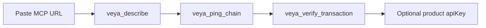

# Quickstart Guide — `@veyanet/mcp`

From zero to a verified chain ping using **public** VEYA surfaces: the paste URL, optional `@veyanet/sdk`, and `https://api.veyanet.tech`.

**[Tools](./TOOLS.md)** • **[Architecture](./ARCHITECTURE.md)** • **[Network pin](./NETWORK_PIN.md)** • **[Verification](./VERIFICATION.md)**

---

## Table of contents

1. [What you will use](#1-what-you-will-use)
2. [Part 1 — Connect the public MCP](#2-part-1--connect-the-public-mcp)
3. [Part 2 — Product API key (writes)](#3-part-2--product-api-key-writes)
4. [Part 3 — TypeScript SDK](#4-part-3--typescript-sdk)
5. [What consensus and sealed mean for you](#5-what-consensus-and-sealed-mean-for-you)
6. [Optional: run the HTTP binary yourself](#6-optional-run-the-http-binary-yourself)
7. [If something fails](#7-if-something-fails)
8. [Next reading](#8-next-reading)
9. [Optional: Paid Call Guard (operators)](#9-optional-paid-call-guard-operators)

---

## 1. What you will use

| Surface | URL / package |
|---------|----------------|
| Public MCP | `https://mcp.veyanet.tech/mcp` |
| MCP health | `https://mcp.veyanet.tech/health` |
| Product API | `https://api.veyanet.tech` |
| TypeScript library | `@veyanet/sdk` on npm |

You need Node only if you install the SDK. Claude/Cursor users need no key to **read**. Product writes need a site API key. On-chain writes need ETH on the selected profile. This tree defaults to Mainnet. Testnet is `ROBINHOOD_NETWORK=testnet`.



---

## 2. Part 1 — Connect the public MCP

### Step 1 — Add the connector

In Claude or Cursor, add a custom MCP server with **Streamable HTTP** (not stdio):

```text
https://mcp.veyanet.tech/mcp
```

Optional check in a terminal:

```bash
curl -s https://mcp.veyanet.tech/health
```

You want `service` = `@veyanet/mcp` and `sealed` mentioning AES-256-GCM. The default `network` is Mainnet.

### Step 2 — Service info

Ask the agent:

> Call `veya_describe` and summarize settlement, sealed, and whether writes are on.

You should see:

- Package `@veyanet/mcp`
- on Mainnet (or Testnet when selected)
- Mainnet contract `0x87dC582eEA544A434a5C1e30Ca3d12c1e548a674`. Testnet contract `0x1a1Dc3c55550FCE9F70ef6cDEeF967c0b72a5d84`
- Sealed = **AES-256-GCM**
- Settlement names the selected profile
- Writes need a product API key **and your funded wallet** (not the hosted relayer)
- Fleet belongs to the product API; unreachable capacity fails closed

### Step 3 — Live chain ping

> Call `veya_ping_chain`.

Confirm a recent block number and the expected contract. The chain ID is checked inside the SDK. If this fails, later verify/write will fail too — RPC or pin problem.

### Step 4 — Verify a real transaction

> Call `veya_verify_transaction` with  
> `0xd68ab19671f0a3be63651cb6d6e24f5decf591da981708502827bca3689d31d8`

Expect parsed `Veya.sol` events (for example `CommitmentStored`) and a digest. Open the Robinhood Chain explorer for the selected network and match the `to` address to the contract.

This proves the commitment is on-chain.

### Step 5 — Product API health

> Call `veya_api_health`.

This is `GET https://api.veyanet.tech/health`. This shows API and fleet status. MCP describe/ping work independently.

---

## 3. Part 2 — Product API key (writes)

Create a `veya_dev_…` or `veya_live_…` key at [app.veyanet.tech](https://app.veyanet.tech): connect your wallet, open **System → API Keys**, and create a Dev (`veya_dev_…`) or Live (`veya_live_…`) key. The key is shown once. Guests cannot mint keys.

> Call `veya_list_environments` with `apiKey` set to that key.

Create environment is an API row (no gas). On-chain writes (`veya_store_commitment`, `veya_register_environment`, `veya_anchor_proof`) need the same key **plus** your wallet private key (`payerPrivateKey` or `VEYA_PAYER_PRIVATE_KEY` on a self-hosted MCP).

If the wallet has no ETH on Mainnet:

```text
Your wallet has no ETH on Robinhood Chain. Add funds and try again.
```

On Testnet the sentence is: `You don't have testnet tokens. Please get them for the transaction.`

`veya_guest_login` still lists Use rooms. Guest is **not** a write credential.

To Build rooms you need a **product API key** from a wallet login. MCP has no wallet popup.

---

## 4. Part 3 — TypeScript SDK

If you are writing a backend or script:

```bash
npm install @veyanet/sdk
```

```ts
import { VeyaClient } from "@veyanet/sdk";

const client = new VeyaClient({
  // default: Mainnet
  // Testnet: network: "testnet"
});

const ping = await client.pingChain();
console.log(ping.chainId.toString()); // matches ROBINHOOD_MAINNET.chainId
```

MCP remains the paste-URL agent surface. The SDK is crypto + chain in **your** process.

---

## 5. What consensus and sealed mean for you

Tools like `veya_run_consensus` and `veya_sealed_execute` exist on the public MCP. They call **fleet URLs configured on the MCP host**. On production those should be the API-owned validators/sealed-node.

If that fleet is down, you get an error or `consensus_reached: false`.

Sealed = **AES-256-GCM**. The public paste URL is `https://mcp.veyanet.tech/mcp`.

---

## 6. Optional: run the HTTP binary yourself

Only if you **operate** a host. Public users should stay on `https://mcp.veyanet.tech/mcp`.

```bash
npm install -g @veyanet/mcp
veya-mcp
# or: npx -y @veyanet/mcp
```

This starts **Streamable HTTP** on `PORT` (default <mcp-port>). Point a local client at `<your-mcp-host>/mcp` for your own tests. After TLS, advertise the public HTTPS URL. See [DEPLOYMENT.md](./DEPLOYMENT.md) and [CONFIGURATION.md](./CONFIGURATION.md).

Set `VEYA_PAYER_PRIVATE_KEY` to **your** wallet on the selected profile if this process will send chain writes. Prefer that over pasting the key into a tool argument.

---

## 7. If something fails

| Symptom | Likely cause |
|---------|----------------|
| Connector timeout | MCP host / TLS |
| Health ok, ping fails | Robinhood RPC |
| Describe ok, guest fails | Product API |
| API health `degraded` | Fleet on API host |
| Create environment refused | Guest JWT is not a product API key |
| Write: apiKey required | Pass `veya_dev_` / `veya_live_` from https://app.veyanet.tech (System → API Keys) |
| Write: empty wallet | Fund **your** wallet. Mainnet is Robinhood Chain Mainnet. Testnet is Robinhood Chain Testnet |

More: [VERIFICATION.md](./VERIFICATION.md).

---

## 8. Next reading

- [TOOLS.md](./TOOLS.md) — every tool, arguments, what it does **not** do  
- [ARCHITECTURE.md](./ARCHITECTURE.md) — pictures of layers and trust  
- [NETWORK_PIN.md](./NETWORK_PIN.md) — chain constants  
- [AUTHENTICATION.md](./AUTHENTICATION.md) — product key vs your wallet  
- [SDK_BRIDGE.md](./SDK_BRIDGE.md) — MCP vs SDK  
- [PAID_CALLS.md](./PAID_CALLS.md) — opt-in Paid Call Guard

---

## 9. Optional: Paid Call Guard (operators)

The public URL does not enable paid calls. A host that wants agents to call paid x402 resources under a VEYA policy turns it on:

1. Build: `npm ci && npm run build`.
2. Place the Solana payer key file and the anchor key file on the host (mode `0600`, outside the repo).
3. Start three validator nodes.
4. Start the server with `VEYA_PAID_CALLS=1`, `VEYA_PAID_ROOT`, `VEYA_PAID_SOLANA_KEY_PATH` and `VEYA_PAID_ANCHOR_KEY_PATH` set.
5. From your client: `veya_paid_discover`, then a blocked call (for example `taskBudgetAtomic: "15000"`), then one allowed `veya_paid_call`.

Full steps, arguments and states: [PAID_CALLS.md](./PAID_CALLS.md).
