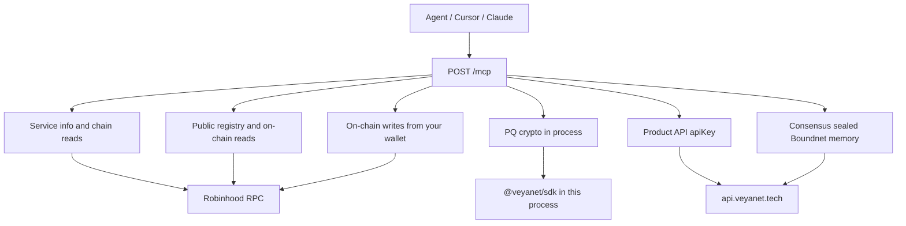

# Tools Reference — `@veyanet/mcp`

This is the full catalog of tools the MCP server can offer an agent (Claude, Cursor, or any MCP client). Every description below is taken from the real handlers in `src/tools/*.ts`. Nothing here is a wishlist.

Paste this URL:

```text
https://mcp.veyanet.tech/mcp
```

Cryptography and chain reads go through `@veyanet/sdk`. Product rooms and registry go through `https://api.veyanet.tech`. Consensus and sealed capacity belong to that API’s fleet. On-chain writes spend **your** wallet (product `apiKey` + `payerPrivateKey`).

Chain tools use the server profile. The default is **Mainnet**. `ROBINHOOD_NETWORK=testnet` selects **Testnet** for the process.

**[Architecture](./ARCHITECTURE.md)** • **[Quickstart](./QUICKSTART.md)** • **[Authentication](./AUTHENTICATION.md)** • **[SDK bridge](./SDK_BRIDGE.md)**

---

## Table of contents

1. [How to read this file](#how-to-read-this-file)
2. [Map: which drawer to open](#map-which-drawer-to-open)
3. [How replies look](#how-replies-look)
4. [1. Service info and public chain reads](#1-service-info-and-public-chain-reads)
5. [2. Post-quantum crypto](#2-post-quantum-crypto-in-this-process)
6. [3. Fleet, sealed, Boundnet, local memory](#3-fleet-sealed-boundnet-local-memory)
7. [4. Public registry and on-chain reads](#4-public-registry-and-on-chain-reads)
8. [5. Product API (apiKey)](#5-product-api-apikey)
9. [6. On-chain write tools (your wallet)](#6-on-chain-write-tools-your-wallet)
10. [Live facts](#live-facts)
11. [Index of tool names](#index-of-tool-names)

---

## How to read this file

Every tool below answers four questions in simple words:

1. **What it does**
2. **When to use it**
3. **Arguments** (what you pass)
4. **What you get back**

Auth is one of:

| Label | Meaning |
|-------|---------|
| **None** | Anyone connected to the MCP URL |
| **Key** | Pass `apiKey` (`veya_dev_…` / `veya_live_…`) from the product site |
| **Key + payer** | Product `apiKey` plus your wallet. Anchored `veya_prove` also needs `environmentId` |

Guest sessions are **Use listing only**. Create environment and product on-chain writes need a product API key. Those writes also need **your** funded wallet on the selected profile. Testnet is optional (`ROBINHOOD_NETWORK=testnet`). Guest JWT is not a write credential. `veya_prove` without `anchor` needs no key. `veya_prove` with `anchor` needs `apiKey`.

If validators or sealed-node are down, consensus/sealed tools return a clear error or `consensus_reached: false`.

`veya_writes_status` is always registered. It explains own-wallet writes. On Mainnet an empty wallet says `Your wallet has no ETH on Robinhood Chain. Add funds and try again.` On Testnet it says `You don't have testnet tokens. Please get them for the transaction.`

**51 tools** (writes always listed).

---

## Map: which drawer to open



| You want to… | Start with |
|--------------|------------|
| Know what this server is | `veya_describe` |
| See if the chain is alive | `veya_ping_chain` |
| Check a known tx | `veya_verify_transaction` |
| Prove text, JSON, or a receipt | `veya_prove` |
| Seal an evidence id and a decision | `veya_seal_decision` |
| Hash text the VEYA way | `veya_hash_blake3` |
| Check product API and fleet status | `veya_api_health` |
| Make PQ keys (no chain) | `veya_pq_keygen` |
| Run 2-of-3 (if fleet up) | `veya_run_consensus` |
| Seal a payload (if sealed up) | `veya_sealed_execute` |
| Browse public agents / certificates | `veya_public_list_*` |
| Stamp a proof from your wallet | `veya_anchor_proof` with `apiKey` + `payerPrivateKey` |
| Build a room | Product API key — not guest |

---

## How replies look

MCP tools return MCP `content` items. This server almost always puts **one text item** whose body is pretty-printed JSON.

| Helper | Used by | Shape |
|--------|---------|--------|
| Raw `JSON.stringify` in the handler | `public.ts` describe/ping/hash/verify/health, writes | Direct object JSON |
| `toolJson(data)` | crypto, fleet, registry, product | Same: JSON text |
| `toolError(err)` | those files on throw | `{ "error": "<message>" }` and `isError: true` |

Product and public-registry tools wrap the HTTP call as:

```json
{ "httpStatus": 200, "body": { } }
```

A guest Build call is an MCP error (`isError: true`) plus the product API `httpStatus` when the call reached the API. Create a product API key at app.veyanet.tech after wallet login.

`veya_api_health` uses `{ "httpStatus", "body" }` from `GET {VEYA_API_URL}/health` (8 second timeout). Other API tools use a 20 second timeout (`src/api.ts`).

Hex arguments: strip `0x` is fine. Environment/agent UUIDs on chain are **16 bytes** (32 hex chars). Digests are **32 bytes** (64 hex chars). Wrong length fails closed.

---

# 1. Service info and public chain reads

**Auth: none.** These are the tools a public user should try first.

## `veya_describe`

**What it does.** Returns a JSON service info from config: package name and version, public paste URL, the selected network: Mainnet (default) or Testnet, with chain id, contract, RPC and explorer, product API URL, sealed = AES-256-GCM, how writes work, and that fleet is API-owned. Use `veya_ping_chain` for a live RPC check.

**When to use it.** First call after connecting. Diligence. “What is this MCP?”

**Arguments.** None.

**What you get back.** JSON text with `name`, `version`, `publicUrl`, `settlement`, `productApi`, `sealed`, `mainnet`, `writes`, `toolSurface`, `fleet`, `publicPasteUrl`.

---

## `veya_ping_chain`

**What it does.** Asks Robinhood Chain JSON-RPC if it is reachable, what chain id it is, and a bit of block/contract context, using `@veyanet/sdk` `VeyaClient.pingChain()`.

**When to use it.** After describe. If this fails, later verify/write will fail too.

**Arguments.** None.

**What you get back.** Ping fields plus `chainId` as a string, `expectedChainId` from config, and `config` from `client.describe()`. This tree's default is Mainnet. Testnet is the profile when `ROBINHOOD_NETWORK=testnet`.

---

## `veya_prove`

**What it does.** One proof entry. Pass exactly one of `text`, `json`, or `txHash`. Text and JSON become a BLAKE3 digest of canonical bytes. The same JSON object hashes the same when its keys are in a different order. Array order is kept. A `0x` + 64 hex transaction hash is read from the live receipt. Success for a hash is a parsed `Veya.sol` log plus the explorer link. A hash with no VEYA log is a refusal.

Without `anchor`, the result is `mode` `digest`, `ok` true, and `anchored` false. No transaction is sent.

With `anchor` true, the call also needs `apiKey`, `environmentId` for an environment that already exists on `Veya.sol`, and `payerPrivateKey`. That writes one `storeCommitment`, then reads the new transaction back. `mode` is `anchored`. A missing API key, a missing payer key, or a missing environment id is a refusal and sends nothing.

**When to use it.** You have text, a JSON value, or a receipt hash and want one proof object.

**Arguments.**

| Name | Type | Required |
|------|------|----------|
| `text` | string | exactly one of text, json, txHash |
| `json` | string, a JSON value | exactly one of text, json, txHash |
| `txHash` | string, `0x` + 64 hex | exactly one of text, json, txHash |
| `anchor` | boolean | no |
| `apiKey` | string | yes when `anchor` is true |
| `environmentId` | string | yes when `anchor` is true |
| `payerPrivateKey` | string | yes when `anchor` is true |

**What you get back.** On a completed call, the proof JSON from `@veyanet/sdk`: `ok`, `mode` (`digest`, `verified`, `anchored`, or `refused`), `inputKind` (`text`, `json`, or `tx`), `digestHex`, `anchored`, `chainId`, `contractAddress`, `txHash`, `explorerUrl`, `event`, `blockNumber`, `refusal`. A refusal sets MCP `isError`. A receipt with no VEYA log and a receipt that called a different contract both return that full object. The second one sets `refusal` to `transaction did not target Veya.sol — not a VEYA proof`. Passing zero or two of `text` / `json` / `txHash`, or a `json` string that is not JSON, returns `isError` with `{ "ok": false, "mode": "refused", "anchored": false, "refusal" }`.

---

## `veya_seal_decision`

**What it does.** One sealed decision. Pass `evidenceId` and `decision`. On Mainnet also pass `environmentId`, or set `VEYA_SEAL_DECISION_ENVIRONMENT_ID` on the host. Without either, the result is `SEAL_ENVIRONMENT_REQUIRED` and nothing is sent. Testnet uses environment `7d0af0ba-2ae3-4d0e-bc75-0bbaccb3dd71` when no id is passed. `decision` is a string that `JSON.parse` reads as an object. If the sealed node does not answer, the result is `code` `SEALED_UNREACHABLE`, `transaction` null, and `continuedOnOpenWorker` false. No transaction is sent.

If the sealed node answers, the result carries the sealed fingerprint, `runtime` `AES-256-GCM`, and a 2-of-3 ML-DSA quorum. `attestExecution` is sent when `payerPrivateKey` is passed on that call. It is also sent when the host has `VEYA_SEAL_DECISION_RELAYER=1` and a relayer key, and the call omits `payerPrivateKey`. With the switch off and no payer key, `chain` is null and nothing is sent. The switch does not enable the host relayer for any other tool.

**When to use it.** You have an evidence id and a decision object, and you want the sealed fingerprint, the quorum, and, when a payer is available, one `attestExecution` receipt.

**Arguments.**

| Name | Type | Required |
|------|------|----------|
| `evidenceId` | string | yes |
| `decision` | string, a JSON object | yes |
| `apiKey` | string | yes |
| `payerPrivateKey` | string | no. Writes the receipt when passed |

**What you get back.** On success, `ok` true, `evidenceId`, `sealed`, `attestation`, and `chain`. `chain` is the `attestExecution` receipt or null. A sealed-node miss sets MCP `isError` and returns the refusal object. A `decision` string that is not a JSON object returns `isError` with `transaction` null and `continuedOnOpenWorker` false.

---

## `veya_hash_blake3`

**What it does.** Hashes your string with **BLAKE3-256** (the same family VEYA uses for commitments). Returns hex.

**When to use it.** You want a digest before `veya_store_commitment` or to compare with an on-chain commitment.

**Arguments.**

| Name | Type | Required |
|------|------|----------|
| `data` | string, min length 1 | yes |

**What you get back.** `{ "hash": "<64-char hex>" }` (shape may include `0x` depending on SDK).

---

## `veya_verify_transaction`

**What it does.** Takes a **mined** Robinhood tx hash, loads the receipt, and parses **Veya.sol** events (commitments and related proofs) through the SDK.

**When to use it.** Someone sent you a tx. You want `valid` / event data / explorer-facing fields without trusting a screenshot.

**Arguments.**

| Name | Type | Required |
|------|------|----------|
| `txHash` | string, min 66 chars (`0x` + 64 hex) | yes |

**What you get back.** SDK verify JSON: typically parsed proofs, hashes, whether the receipt looks like a VEYA write. This is chain-receipt data (what landed on `Veya.sol`).

**Example hash used in docs:**

```text
0xd68ab19671f0a3be63651cb6d6e24f5decf591da981708502827bca3689d31d8
```

---

## `veya_api_health`

**What it does.** `GET {VEYA_API_URL}/health` (default `https://api.veyanet.tech/health`). Returns HTTP status and body.

**When to use it.** You care whether the **product API** (database, relayer, **validators**, **sealed**) is `ok` or **`degraded`**. Degraded usually means fleet down. MCP describe/ping can still work.

**Arguments.** None.

**What you get back.** `{ httpStatus, body }` — body includes `status`, `validators.reachable`, `sealed.reachable`, Robinhood relayer block.

---

## `veya_writes_status`

**What it does.** Always registered. Explains that on-chain writes are **own-wallet**: product `apiKey` + your wallet. Does not use the hosted relayer.

**When to use it.** Before a write, to confirm who pays gas.

**Arguments.** None.

**What you get back.** `{ userPaidWrites: true, operatorRelayerWrites, requires, gasPayer, emptyWallet }`.

---

# 2. Post-quantum crypto (in this process)

**Auth: none.** Keys are generated **here**, not on chain, unless you later call a own-wallet write tool.

Treat `privateKeyHex` like a secret. Do not paste it into public chats.

## `veya_pq_keygen`

**What it does.** Makes an **ML-DSA-44** keypair (FIPS 204 style identity used across VEYA). Also returns BLAKE3 of the public key.

**When to use it.** You need an agent/operator PQ identity before signing or registering on chain.

**Arguments.** None.

**What you get back.** `publicKeyHex`, `privateKeyHex`, `publicKeyHash`. Keep `privateKeyHex` secret.

---

## `veya_pq_sign`

**What it does.** Signs a UTF-8 **message** with ML-DSA-44 using `privateKeyHex`.

**Arguments.**

| Name | Type | Required |
|------|------|----------|
| `message` | string | yes |
| `privateKeyHex` | hex string | yes |

**What you get back.** `{ signatureHex }`. The message is the UTF-8 string you passed.

---

## `veya_pq_verify`

**What it does.** Checks an ML-DSA-44 signature over UTF-8 text.

**Arguments.** `message`, `signatureHex`, `publicKeyHex` (all required).

**What you get back.** `{ valid: true | false }`.

---

## `veya_pq_fingerprint`

**What it does.** BLAKE3 fingerprint of an ML-DSA public key (hex in, hash out). Same idea as the hash stored on chain for identities.

**Arguments.** `publicKeyHex`.

**What you get back.** `{ publicKeyHash }`.

---

# 3. Fleet, sealed, Boundnet, local memory

These call **SDK** helpers. On a public host, validator/sealed URLs should point at **API-owned** capacity. If nothing is listening, you get an error or `consensus_reached: false`.

The fleet stays private; the MCP server reaches it on the API machine.

## `veya_run_consensus`

**What it does.** Sends the same `payload` to validator nodes (`POST /execute`). Each node hashes with BLAKE3 and signs with its ML-DSA identity. The SDK checks whether **at least 2 of 3** matching hashes exist.

**When to use it.** You need a quorum digest before attesting on chain.

**Arguments.**

| Name | Type | Required |
|------|------|----------|
| `apiKey` | string | yes |
| `taskId` | string | yes |
| `payload` | object | no (default `{}`) |

**What you get back.** `ConsensusResult`: `task_id`, `agreed_blake3_hash` (or null), `node_results`, `consensus_reached`, `threshold`, `reachable`. Agreement is **hash equality**. If two nodes are down, `consensus_reached` is false.

---

## `veya_client_run_consensus`

**What it does.** Deprecated: use `veya_run_consensus`. Same server validator list. Needs a product API key.

**When to use it.** You want the client defaults, not a custom URL list.

**Arguments.** `apiKey` (string, needed at call time), `taskId` (string, required), `payload` (object, default `{}`).

---

## `veya_sealed_execute`

**What it does.** Sends a payload to **sealed-node** (`POST /protected`). Seal is **AES-256-GCM**, plus BLAKE3 of ciphertext and ML-DSA over the execution hash. The tool then runs `requireVerifiedSeal` so a 200 with `verified: false` cannot look like success.

**When to use it.** Sensitive agent payload that should not sit in plaintext on the API process.

**Arguments.**

| Name | Type | Required |
|------|------|----------|
| `apiKey` | string | yes |
| `environmentId` | string | yes |
| `agentId` | string | yes |
| `eventType` | string | yes |
| `payload` | object | yes |
| `sessionEntropyHex` | hex, min 16 chars | yes |

**What you get back.** Sealed execution result JSON (commitment, verified flag, hashes). If unverified, the call errors. Seal is **AES-256-GCM**.

---

## `veya_set_tool_policy`

**What it does.** Allow or deny a tool for an agent. Needs the API key that owns the environment. The rule is saved on that account. Arguments: `apiKey`, `environmentId`, `agentId`, `tool`, `allowed`.

---

## `veya_route_message`

**What it does.** Checks the saved tool rule for this API key (`fromAgent` calling `tool`). Returns `policyStatus` `allowed` or `denied`. Arguments: `apiKey`, `environmentId`, `id`, `fromAgent`, `toAgent`, `tool`, `payload`.

**What you get back.** Route result including `policyStatus` (`allowed` / `denied`). Denied stays `denied`.

---

## `veya_route_secure_message`

**What it does.** Same policy check, then wraps the message in a **Kyber-768** session and **ML-DSA-44** signature (harvest-now resistant envelope).

**Arguments.** `apiKey`, `environmentId`, the route fields `id`, `fromAgent`, `toAgent`, `tool`, `payload`, then `senderPrivateKeyHex` and `senderPublicKeyHex`.

**What you get back.** Secure envelope JSON (session id, signature, policy status).

---

## `veya_verify_secure_message`

**What it does.** Verifies the ML-DSA signature on a secure envelope.

**Arguments.** `message` (object), `senderPublicKeyHex`.

**What you get back.** `{ valid }`.

---

## `veya_store_memory` / `veya_read_memory` / `veya_invalidate_memory`

**What they do.** Agent memory saved on the account behind the API key, through the product API (`/v1/environments/:id/scoped-memory`). Only the owner can read or nullify it. No key, no access.

**Arguments.**

| Tool | Args |
|------|------|
| store | `apiKey`, `environmentId`, `agentId`, `data` |
| read | `apiKey`, `environmentId`, `id` |
| invalidate | `apiKey`, `environmentId`, `id` |

---

# 4. Public registry and on-chain reads

**Auth: none.** Registry JSON comes from the **product API** `/public/*`. On-chain reads use SDK `eth_call` against `Veya.sol`.

| Tool | Backend |
|------|---------|
| `veya_public_stats` | `GET /public/stats` |
| `veya_public_list_agents` | `GET /public/agents?limit&offset` |
| `veya_public_get_agent` | `GET /public/agents/:id` |
| `veya_public_list_certificates` | `GET /public/certificates?limit&offset` |
| `veya_public_get_certificate` | `GET /public/certificates/:id` |
| `veya_public_get_execution` | `GET /public/executions/:id` |
| `veya_verify_commitment_onchain` | SDK: parse events + `commitments(digest)` |
| `veya_commitment_exists` | SDK: `commitments(bytes32)` |
| `veya_read_environment_onchain` | SDK: environment by 16-byte UUID |
| `veya_read_agent_onchain` | SDK: agent by 16-byte UUID |

Return wrapper for `/public/*` tools: `{ httpStatus, body }`.

## `veya_public_stats`

**What it does.** Public counts (agents, proofs, whatever `/public/stats` returns).

**When to use it.** Landing-style “what is live” without a session.

---

## `veya_public_list_agents` / `veya_public_get_agent`

**What they do.** List or fetch **public** agent registry rows (public fields only).

**Arguments.** List: optional `limit` (1–100), `offset`. Get: `id`.

---

## `veya_public_list_certificates` / `veya_public_get_certificate`

**What they do.** Public attestation / certificate explorer rows (the public proof/certificate surface of the product API).

**Arguments.** List: optional `limit`, `offset`. Get: `id`.

---

## `veya_public_get_execution`

**What it does.** Fetch one public execution proof by `id` from `/public/executions/:id`.

---

## `veya_verify_commitment_onchain`

**What it does.** Stronger than event-only verify: parse `CommitmentStored` (and related) from the tx, then **`eth_call` `commitments(digest)`** for each digest so the mapping still says the hash exists.

**Arguments.** `txHash` (66+ chars).

**When to use it.** Diligence: “event in the receipt **and** mapping still true.”

---

## `veya_commitment_exists`

**What it does.** `eth_call` `commitments(bytes32)` for one digest.

**Arguments.** `digestHex` (32-byte hex).

**What you get back.** `{ digestHex, onChain: true|false }`.

---

## `veya_read_environment_onchain` / `veya_read_agent_onchain`

**What they do.** Read `Veya.sol` environment or agent records by **16-byte UUID hex**. Wrong UUID length fails closed.

**Arguments.** `environmentUuidHex` or `agentUuidHex` (min 32 hex chars).

---

# 5. Product API (apiKey)

These tools call `https://api.veyanet.tech` (or `VEYA_API_URL`). Return wrapper: `{ httpStatus, body }`.

**Auth: Key** — pass `apiKey` (`veya_dev_…` / `veya_live_…`) unless noted. Guest JWT may list only.

| Tool | HTTP |
|------|------|
| `veya_guest_login` | `POST /auth/guest` (no token; listing only) |
| `veya_account` | `GET /v1/account` |
| `veya_list_environments` | `GET /v1/environments` |
| `veya_get_environment` | `GET /v1/environments/:id` |
| `veya_create_environment` | `POST /v1/environments` (no gas) |
| `veya_list_agents` | `GET /v1/environments/:id/agents` |
| `veya_deploy_agent` | `POST /v1/environments/:id/agents` |
| `veya_list_api_memory` | `GET /v1/environments/:id/memory` |
| `veya_list_executions` | `GET /v1/environments/:id/executions` |
| `veya_run_protected_execution` | `POST /v1/environments/:id/executions/protected` |
| `veya_boundnet_invoke` | `POST /v1/environments/:id/boundnet/invoke` |
| `veya_list_proofs` | `GET /v1/proofs` |
| `veya_anchor_proof` | Own-wallet `storeCommitment` (not the hosted relayer stamp) |
| `veya_verify_proof_api` | `GET /api/verify/:signature` (no key) |

### Guest vs product key

| Action | Guest JWT | Product API key |
|--------|-----------|-----------------|
| Login | `veya_guest_login` | Mint key on the product site after wallet login |
| List showcase / Use rooms | Yes | Yes |
| Create environment (API row) | Refused by MCP | Yes (no gas) |
| Deploy agent / protected / Boundnet | Refused / 403 | Yes |
| On-chain stamp | Refused | Yes — **your** wallet pays |

---

## `veya_guest_login`

**What it does.** `POST /auth/guest` on the product API. Returns a JWT for **Use listing only**.

**When to use it.** Browse showcase rooms. Not for writes.

**Arguments.** None.

**What you get back.** Token, `mode: guest`. Guest writes from MCP are refused.

---

## `veya_account`

**What it does.** `GET /v1/account` — wallet bound to this API key.

**Arguments.** `apiKey`.

---

## `veya_list_environments` / `veya_get_environment`

**What they do.** List rooms for the key, or get one by `environmentId`. Guest JWT sees Use/showcase scope.

**Arguments.** `apiKey` (required). Get also needs `environmentId`.

---

## `veya_create_environment`

**What it does.** `POST /v1/environments` — **Build** API row. Does **not** spend gas. Register on chain with `veya_register_environment`. Names that start with test, demo, tmp, sandbox, or e2e are refused. Use a real workspace name of at least 6 characters, or a name that starts with VEYA.

**Arguments.** `apiKey` (or `sessionToken`), `name`, optional `type` (`research` \| `governance` \| `treasury` \| `contributor` \| `protocol` \| `desci`). Omitted `type` is stored as `research`. Creating a workspace sends no transaction.

**Guest:** refused (`apiKey` must be a product key).

---

## `veya_list_agents` / `veya_deploy_agent`

**What they do.** List agents in a room, or deploy one (**Build**).

**Deploy arguments.** `apiKey`, `environmentId`, optional `type` (stored as `coordination` when omitted), `agentKind` (a display name of at least 3 characters; the API refuses an agent without it), optional `permissionConfig`. Put the tool names in `permissionConfig.allowedTools`. If that list is omitted, the agent cannot call a tool. Deploying an agent does not perform a payment.

---

## `veya_list_api_memory` / `veya_list_executions`

**What they do.** List **product API** memory rows or execution rows for an environment (hosted DB).

**Arguments.** `apiKey` or `sessionToken`, `environmentId`. Memory also takes optional `scope`: `environment` \| `agent` \| `session`.

---

## `veya_run_protected_execution`

**What it does.** `POST .../executions/protected` on the API — sealed path as the **hosted product** runs it (AES-256-GCM on the API’s sealed-node). **Build.** Product `apiKey` required.

**Arguments.** `apiKey` (or `sessionToken`), `environmentId`, `agentId`, `eventType`, `payload`, optional `disclose` / `seal` field name lists (sent to the API as `discloseFields` / `sealFields`).

---

## `veya_boundnet_invoke`

**What it does.** `POST .../boundnet/invoke` — agent may call `toolName` only if policy allows.

**Arguments.** `apiKey` (or `sessionToken`), `environmentId`, `agentId`, `toolName`, optional `arguments` object.

---

## `veya_list_proofs` / `veya_anchor_proof`

**What they do.** List stamps, or hash `label` + `content` with BLAKE3 and `storeCommitment` from **your** wallet.

**Guest:** MCP refuses. Create a product API key at app.veyanet.tech and fund your wallet.

**Anchor arguments.** `apiKey`, `payerPrivateKey` (or env), `label`, `content`, optional product `environmentId`.

**What you get back.** `{ txHash, explorer, from, hash, label, recorded }` (plus `recordError` if the proof list could not save it). `from` is your address.

Empty wallet: Mainnet: `Your wallet has no ETH on Robinhood Chain. Add funds and try again.` Testnet: `You don't have testnet tokens. Please get them for the transaction.`

---

## `veya_verify_proof_api`

**What it does.** Public product verify: `GET /api/verify/:signature` (tx hash). No key required. It checks a commitment or anchor transaction. A registration transaction is not a proof and returns `NOT_VEYA_TX`.

**Arguments.** `signature` (tx hash string).

**What you get back.** `{ valid: true|false, ... }` — failures are visible, not hidden.

---

# 6. On-chain write tools (your wallet)

Always registered. Every call needs a product `apiKey` and a funded `payerPrivateKey` (tool arg or `VEYA_PAYER_PRIVATE_KEY`). `msg.sender` is **your** address. The hosted relayer is not used.

Empty wallet:

```text
Mainnet: Your wallet has no ETH on Robinhood Chain. Add funds and try again.
Testnet: You don't have testnet tokens. Please get them for the transaction.
```

Prefer self-hosting MCP so the private key stays in env, not in a tool argument to the public URL.

## `veya_store_commitment`

Stores a 32-byte digest on `Veya.sol` `storeCommitment` for a 16-byte environment UUID.

**Args.** `apiKey`, `payerPrivateKey`, `environmentUuidHex`, `commitmentHex`.

**Returns.** `{ txHash, explorer, from }`.

---

## `veya_attest_execution`

`attestExecution` with BLAKE3 execution hash and ML-DSA signature bytes.

**Args.** `apiKey`, `payerPrivateKey`, `environmentUuidHex`, `blake3HashHex`, `mldsaSigHex`.

---

## `veya_register_environment`

`registerEnvironment` from your wallet. Pass product `environmentId` to load the UUID from the product API and confirm the tx so the console sees it (`consoleSynced`). Do not retry if the on-chain `txHash` is already returned.

**Args.** `apiKey`, `payerPrivateKey`, `environmentId` **or** `environmentUuidHex`, optional `pqPubkeyHashHex`, `envType`.

---

## `veya_register_pq_onchain`

Generates ML-DSA keys in process, then registers environment + a commitment on chain from your wallet.

**Args.** `apiKey`, `payerPrivateKey`, optional `envType` (default 1).

**Returns.** public key hex/hash, `environmentTx`, `memoTx`, explorer, `from`. Do not log private keys.

---

## `veya_anchor_pq_attestation`

Links identity hash to execution hash on chain (`anchorPqAttestation`).

**Args.** `apiKey`, `payerPrivateKey`, `environmentUuidHex`, `identityHashHex`, `executionHashHex`.

---


# Live facts

| Claim | Live value |
|-------|--------|
| Sealed | AES-256-GCM |
| This tree | Mainnet unless `ROBINHOOD_NETWORK=testnet` |
| Guest Build | 403 |
| Quorum | Real 2-of-3 or fail closed |
| `Veya.sol` | Protocol contract |
| Public path | Public MCP + npm SDK + `api.veyanet.tech` |

## Index of tool names

| Tool | Group | Auth |
|------|-------|------|
| `veya_describe` | Public | None |
| `veya_ping_chain` | Public | None |
| `veya_hash_blake3` | Public | None |
| `veya_verify_transaction` | Public | None |
| `veya_prove` | Public read; anchor needs an API key and a payer | API key and payer key when `anchor` is true |
| `veya_seal_decision` | Sealed decision; receipt when a payer is passed or the seal-decision relayer switch is on | API key; `payerPrivateKey` optional |
| `veya_api_health` | Public | None |
| `veya_writes_status` | Writes | None |
| `veya_pq_keygen` | Crypto | None |
| `veya_pq_sign` | Crypto | None |
| `veya_pq_verify` | Crypto | None |
| `veya_pq_fingerprint` | Fleet file | None |
| `veya_run_consensus` | Fleet (server validators) | API key |
| `veya_client_run_consensus` | Fleet (deprecated alias) | API key |
| `veya_sealed_execute` | Fleet (server sealed node) | API key |
| `veya_set_tool_policy` | Account | API key |
| `veya_route_message` | Account | API key |
| `veya_route_secure_message` | Account | API key |
| `veya_verify_secure_message` | Fleet | None |
| `veya_store_memory` | Account | API key |
| `veya_read_memory` | Account | API key |
| `veya_invalidate_memory` | Account | API key |
| `veya_public_stats` | Registry | None |
| `veya_public_list_agents` | Registry | None |
| `veya_public_get_agent` | Registry | None |
| `veya_public_list_certificates` | Registry | None |
| `veya_public_get_certificate` | Registry | None |
| `veya_public_get_execution` | Registry | None |
| `veya_verify_commitment_onchain` | Registry | None |
| `veya_commitment_exists` | Registry | None |
| `veya_read_environment_onchain` | Registry | None |
| `veya_read_agent_onchain` | Registry | None |
| `veya_guest_login` | Product | None (listing only) |
| `veya_account` | Product | Key |
| `veya_list_environments` | Product | Key |
| `veya_get_environment` | Product | Key |
| `veya_create_environment` | Product | Key |
| `veya_list_agents` | Product | Key |
| `veya_deploy_agent` | Product | Key |
| `veya_list_api_memory` | Product | Key |
| `veya_list_executions` | Product | Key |
| `veya_run_protected_execution` | Product | Key |
| `veya_boundnet_invoke` | Product | Key |
| `veya_list_proofs` | Product | Key |
| `veya_anchor_proof` | Writes | Key + payer |
| `veya_verify_proof_api` | Product | None |
| `veya_store_commitment` | Writes | Key + payer |
| `veya_attest_execution` | Writes | Key + payer |
| `veya_register_environment` | Writes | Key + payer |
| `veya_register_pq_onchain` | Writes | Key + payer |
| `veya_anchor_pq_attestation` | Writes | Key + payer |

## Related

- [ARCHITECTURE.md](./ARCHITECTURE.md) — pictures of how tools sit in the system  
- [AUTHENTICATION.md](./AUTHENTICATION.md) — product key vs your wallet  
- [SDK_BRIDGE.md](./SDK_BRIDGE.md) — what is SDK vs API
- [NETWORK_PIN.md](./NETWORK_PIN.md) — chain constants  
- [QUICKSTART.md](./QUICKSTART.md) — first five minutes  
- [TRANSPORT.md](./TRANSPORT.md) — tool policy is saved on the account